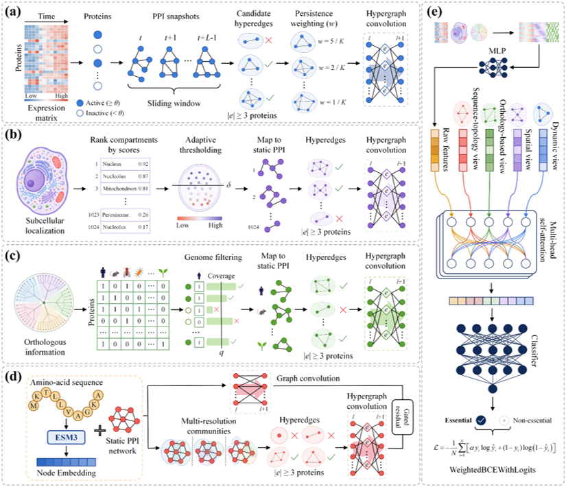

<h1 align="center">HyVistaEP</h1>

<p align="center">
  <strong>Multi-view hypergraph learning for essential protein prediction</strong>
</p>

HyVistaEP integrates temporal gene expression, subcellular localization,
orthology, protein sequence representations, and PPI topology within a unified
hypergraph framework. This repository provides the complete training and
evaluation workflow for *S. cerevisiae*, *H. sapiens*, *D. melanogaster*, and
*E. coli*, together with processed inputs and ten-fold pretrained models.

## 🧬 Model Architecture

<p align="center">
  
</p>

<p align="center">
  <em>Overview of the HyVistaEP framework and its multi-view feature-fusion pipeline.</em>
</p>

## 🛠️ 1. Environment Setup

Python 3.10 and a CUDA-enabled GPU are recommended.

```bash
python -m pip install -r requirements.txt
export OMP_NUM_THREADS=1
export OPENBLAS_NUM_THREADS=1
export MKL_NUM_THREADS=1
```

## 🚀 2. Data Preparation

Prepare the graph data for all four species:

```bash
python -u src/prepare_data.py --data-root data
```

Data preparation is also invoked automatically when training or evaluation
starts, so this command may be omitted in the standard workflow.

## 🔍 3. Evaluate Pretrained Models

Evaluate one species with the supplied ten-fold checkpoints:

```bash
python -u src/test.py \
  --species yeast \
  --data-root data \
  --checkpoint-dir checkpoints/yeast
```

Evaluate all four species:

```bash
bash scripts/test_all_species.sh
```

Accepted species names are `yeast`, `human`, `melanogaster`, and `coli`.

## 🧠 4. Train and Evaluate

Run a short end-to-end training and evaluation test:

```bash
bash scripts/smoke_test.sh
```

Run ten-fold training for one species:

```bash
python -u src/train.py \
  --species yeast \
  --data-root data \
  --output-dir outputs/yeast \
  --seed 45 \
  --folds 10
```

Evaluate the resulting checkpoints:

```bash
python -u src/test.py \
  --species yeast \
  --data-root data \
  --checkpoint-dir outputs/yeast
```
